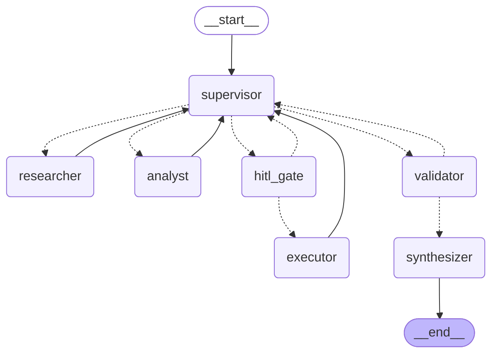

# API de producción para el orquestador multi-agente — Pre-entrega 7

API REST (FastAPI) que expone el sistema multi-agente del Módulo 6 (LangGraph: supervisor → researcher / analyst → validator → synthesizer) con cuatro capacidades nuevas:

| Capacidad | Cómo está resuelta | Dónde |
|---|---|---|
| **Endpoints asíncronos** | `POST /tasks` guarda el job, lo lanza en una `asyncio.Task` y responde `202 + job_id` al instante. Todos los nodos del grafo son `async` nativos (`ainvoke`), nada bloquea el event loop. | `app/main.py`, `app/worker.py`, `app/graph.py` |
| **Estado en Redis** | Estado de cada job (`PENDING/RUNNING/AWAITING_APPROVAL/DONE/FAILED`) en `job:{id}` + **checkpoints de LangGraph** con `AsyncRedisSaver` (`thread_id = job_id`). Cualquier excepción en segundo plano → `FAILED`. | `app/store.py`, `app/worker.py`, `app/main.py` |
| **Observabilidad** | Arize Phoenix vía OpenInference (o LangSmith por variables de entorno). Un span por nodo, por llamada al LLM y por tool; las trazas de un job se agrupan por `session_id = job_id`. | `app/observability.py` |
| **Human-in-the-loop** | Nuevo agente `executor` con tools de **efectos secundarios** (publicar precio, enviar email). Siempre pasa antes por `hitl_gate`, que hace `interrupt()` y pausa el grafo hasta `POST /tasks/{id}/approve`. | `app/hitl.py`, `app/agents/executor_agent.py` |

## Topología del grafo



Líneas punteadas = aristas condicionales. Lo nuevo respecto del M6 es `executor` + `hitl_gate`.

## Cómo inicializar (paso a paso)

Requisitos: **Python 3.12+**, Docker (para Redis Stack y Phoenix) y una API key de un LLM.

```bash
# 1) Clonar e instalar
git clone <url-de-este-repo> && cd <repo>
python -m venv .venv && source .venv/bin/activate      # Windows: .venv\Scripts\activate
pip install -r requirements.txt

# 2) Variables de entorno
cp .env.example .env            # completá OPENAI_API_KEY (o la del proveedor que uses)

# 3) Levantar Redis Stack + Phoenix
docker compose up -d redis phoenix
#    Redis -> localhost:6379   |   Phoenix UI -> http://localhost:6006

# 4) Levantar la API (UN solo worker)
uvicorn app.main:app --port 8000
#    Docs interactivas: http://localhost:8000/docs
```

> **Importante:** el checkpointer de LangGraph necesita **Redis Stack** (módulos RedisJSON + RediSearch). Con un Redis común la API no arranca y te lo dice con un mensaje claro. `docker-compose.yml` ya usa la imagen correcta.
>
> Todo en contenedores: `docker compose up -d --build` (levanta también la API en `:8000`).

## Endpoints

| Método | Ruta | Qué hace |
|---|---|---|
| `POST` | `/tasks` | Body `{"question": "...", "max_steps": 8}` → `202 {"job_id", "status": "PENDING", "status_url"}` |
| `GET` | `/tasks/{job_id}` | Estado completo: `status`, `answer`, `error`, `steps` (quién aportó qué), `approval_request`, `elapsed_s` |
| `POST` | `/tasks/{job_id}/approve` | Body `{"approved": true, "comment": "..."}`. Solo válido si el job está `AWAITING_APPROVAL` (`409` si no; una sola aprobación gana si llegan dos juntas) |
| `GET` | `/health` | API + Redis + backend de observabilidad activo |

Ciclo de vida: `PENDING → RUNNING → DONE`, o `RUNNING → AWAITING_APPROVAL → (approve) → PENDING → RUNNING → DONE`, o `→ FAILED` ante cualquier error / timeout.

```bash
curl -s -X POST localhost:8000/tasks -H 'content-type: application/json' \
  -d '{"question": "Buscá las reseñas de Zenbuds, analizá el sentimiento y decime qué porcentaje es positivo."}'
# {"job_id":"3f2c...","status":"PENDING","status_url":"http://localhost:8000/tasks/3f2c..."}

curl -s localhost:8000/tasks/3f2c...      # repetir hasta status = DONE
```

## Prueba de carga y capturas (5 peticiones concurrentes)

```bash
python scripts/load_test.py          # dispara 5 POST /tasks en el mismo instante y espera a que terminen
```

Imprime la latencia de cada una y p50 / p95 del lado del cliente (y guarda `load_test_results.json`). **La evidencia que se entrega sale del dashboard**, con esa misma corrida:

1. Abrí Phoenix → proyecto `orchestrator` y filtrá el rango de tiempo de la corrida (deben verse 5 trazas `orchestrator`). Las capturas de evidencia se sacan de este proyecto; el proyecto `multi-agent-api` solo tiene spans HTTP de FastAPI y no es parte de la evidencia.
2. `screenshots/01_trazas.png`: lista de trazas + una abierta mostrando los spans por nodo.
3. `screenshots/02_costo_por_ejecucion.png`: columna **Cost** de cada traza (y/o el costo total del proyecto).
4. `screenshots/03_latencia_p95.png`: cuantiles de latencia del proyecto (o la tabla de trazas ordenada por latencia).
5. Lectura (consigna, paso 4): en una traza abierta, qué nodo concentra la **latencia** y cuál consume más **tokens** (abrí `researcher` / `analyst` / `supervisor` y compará).

Detalles que conviene saber antes de capturar:

- **Proveedores soportados** (`LLM_PROVIDER=…`): `openai` (OPENAI_API_KEY), `gemini` (GOOGLE_API_KEY o GEMINI_API_KEY), `groq` (GROQ_API_KEY), `anthropic` (ANTHROPIC_API_KEY). El modelo se fija con `LLM_MODEL`; los defaults están en `app/llm.py`. `LLM_MAX_RETRIES` (default 6) controla los reintentos del cliente ante 429 / 5xx para Gemini y Groq.
- **Proyectos en Phoenix.** El `config` del grafo (`app/worker.py`) manda `run_name="orchestrator"`; `openinference-instrumentation-langchain` lo usa como `openinference.project.name` para toda la cadena LangChain/LangGraph, así que **las trazas del agente caen en el proyecto `orchestrator`** y las capturas de evidencia salen de ahí. El proyecto `multi-agent-api` queda con spans HTTP (`POST /tasks`, `GET /tasks/{job_id}`, `fastapi.endpoint`, `fastapi.serialization`, `fastapi.dependencies`) que emite `opentelemetry.instrumentation.fastapi:FastAPIInstrumentor` (dependencia transitiva de `arize-phoenix`; se activa cuando Phoenix corre en el mismo proceso/venv) y no es parte de la evidencia.
- **El costo lo calcula Phoenix solo** a partir de `llm.token_count.*` + `llm.model_name` + `llm.provider`. Con `gpt-4o-mini` (OpenAI) y Groq ya está en su tabla de precios. Si usás un modelo que Phoenix no conoce (ej. `openai/gpt-oss-120b` o modelos nuevos de Gemini) el costo sale vacío: cargalo en *Settings → Models → Add new model* (nombre, patrón regex, precio por 1M tokens de entrada y salida) y recién ahí hacé la corrida.
- **p95 con 5 muestras:** el p95 de 5 valores es prácticamente la traza más lenta. Si tu versión de Phoenix no muestra "P95" literal, capturá la tabla ordenada por latencia y mostrá el valor máximo; el número del script (`p95_s`) sirve para cruzar.
- Si el proveedor tiene rate limit bajo (free tier), 5 en paralelo pueden dar errores 429 → aparecen como `FAILED` en el job. Reintentá o usá otro modelo.
- Para **LangSmith**: `OBSERVABILITY=langsmith` + `LANGSMITH_TRACING=true`, `LANGSMITH_API_KEY`, `LANGSMITH_PROJECT`. Mismo procedimiento sobre su dashboard de *Monitoring*.

## Human-in-the-loop

**Qué es "crítico" acá:** todo lo que pase por el `executor`, porque sus tools tienen efectos secundarios (`publish_price_update`, `send_email`; simuladas: escriben en `outbox.jsonl`). El supervisor solo lo elige si la consigna pide publicar/enviar algo, y **no existe ninguna arista que llegue a `executor` sin pasar por `hitl_gate`**.

```bash
python scripts/hitl_demo.py          # manda una tarea que pide PUBLICAR un precio y te pide aprobar por consola
python scripts/hitl_demo.py --reject # idem, rechazando
cat outbox.jsonl                     # la acción solo aparece si aprobaste
```

Qué pasa por dentro: `hitl_gate` llama `interrupt(...)` → LangGraph guarda un checkpoint en Redis y devuelve el control → el worker pone el job en `AWAITING_APPROVAL` con el detalle de lo que se pide aprobar → `POST /approve` reanuda con `Command(resume=...)`. Aprobado → corre `executor`. Rechazado → queda registrado como aporte "ACCIÓN RECHAZADA", no se ejecuta nada y el flujo cierra normalmente.

Como el estado está en Redis (y no en memoria), un job pausado **sobrevive a un reinicio de la API** y se puede aprobar después.

## Decisiones de diseño

- **Worker = `asyncio.Task` en el mismo proceso** (lo que pide la etapa). Para escalar: reemplazar `JobRunner` por una tarea de Arq/Celery; el contrato de la API no cambia.
- **Un solo proceso de uvicorn.** Al arrancar, los jobs `PENDING/RUNNING` huérfanos pasan a `FAILED` (si no, el cliente haría polling para siempre). Con varios workers esa limpieza necesitaría un lock/heartbeat. Los `AWAITING_APPROVAL` no se tocan.
- **Errores de segundo plano:** el worker atrapa todo (`Exception`, timeout, cancelación al apagar) y deja `FAILED` + mensaje en Redis. Timeout por job: `JOB_TIMEOUT_SECONDS`.
- **Escrituras atómicas del job:** `WATCH/MULTI` (optimistic locking) en `store.py`; de ahí sale el `409` ante doble aprobación.
- **Tope de concurrencia:** `MAX_CONCURRENT_JOBS` (semáforo); el resto espera en `PENDING`.
- **TTL:** estado de jobs y checkpoints expiran solos (`JOB_TTL_SECONDS`, `CHECKPOINT_TTL_MINUTES`).
- Las guardas anti-bucle del M6 (`max_steps`, `MAX_REVISIONS`, guardas del supervisor) se mantienen; se agregó la guarda "el `executor` se pide una sola vez".

## Estructura

```
app/
  main.py             # FastAPI: POST /tasks, GET /tasks/{id}, POST /tasks/{id}/approve, /health
  worker.py           # JobRunner: corre el grafo en background; FAILED ante cualquier excepción
  store.py            # estado de jobs en Redis (WATCH/MULTI)
  graph.py            # StateGraph (M6 + executor + hitl_gate) con checkpointer
  hitl.py             # nodo de aprobación humana (interrupt)
  observability.py    # init de Phoenix (OpenInference) / LangSmith
  config.py schemas.py llm.py state.py prompts.py supervisor.py validator.py   # M6 (adaptado a async)
  agents/             # research, analyst (M6) + executor (PE7)
data/knowledge_base.json
scripts/load_test.py  # 5 peticiones concurrentes
scripts/hitl_demo.py  # demo del flujo de aprobación
tests/                # 22 tests offline
screenshots/          # capturas del dashboard (evidencia)
docker-compose.yml  Dockerfile  requirements.txt  .env.example
```

## Tests (sin API key, sin LLM, sin Redis Stack)

```bash
pytest -q
REDIS_TEST_URL=redis://localhost:6379/15 pytest -q    # opcional: contra un Redis real
```

Cubren: la API responde sin esperar al agente, 5 jobs en paralelo, excepción → `FAILED` (persistido en Redis), timeout → `FAILED`, jobs huérfanos, HITL por HTTP (aprobar / rechazar / doble aprobación / 404 / 409), y que la tool con efecto secundario **no se ejecuta hasta que un humano aprueba** (agente ReAct real con LLM guionado). Los tests usan `InMemorySaver` en lugar de `AsyncRedisSaver` (misma interfaz; el segundo requiere Redis Stack).

Versiones con las que se probó: Python 3.13, langgraph 1.2, langgraph-checkpoint-redis 0.5, fastapi 0.143, redis-py 8.1.
